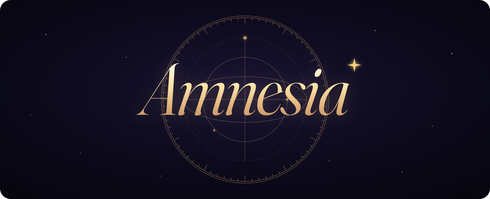

<div align="center">

<a href="https://amne-sia.vercel.app"></a>

### Un puzzle-diorama à travers l’archipel des émotions

*Quelqu’un dort et ne se réveille plus, perdu dans sa propre tête.<br>
Guide **Lumi**, sa dernière petite flamme, à travers chacun de ses sentiments pour en rapporter la gemme.*

<br>

[](https://amne-sia.vercel.app)


</div>

---

## Sommaire

- [Le jeu](#le-jeu)
- [L’histoire](#lhistoire)
- [Les îles](#les-îles)
- [Mécaniques](#mécaniques)
- [Pièges et obstacles](#pièges-et-obstacles)
- [À découvrir](#à-découvrir)
- [Commandes](#commandes)
- [Fonctionnalités](#fonctionnalités)
- [Lancer le projet](#lancer-le-projet)
- [Structure du code](#structure-du-code)
- [Crédits](#crédits)

---

## Le jeu

**Amnesia** est un jeu de réflexion en 3D qui se joue directement dans le navigateur. Chaque niveau est une **île flottante**, un petit diorama qu’on fait pivoter pour en trouver le chemin. Lumi n’attaque pas et ne saute pas : il marche, pousse, écoute et observe. Pour avancer, il faut lire le terrain.

- **9 îles**, du prologue à l’épilogue, chacune liée à une émotion qui lui donne son ciel, sa musique et son esprit.
- **Des esprits doublés** qui racontent leur histoire réplique après réplique, et glissent souvent un indice.
- **Une mécanique nouvelle par île**, présentée par un court tutoriel au moment où elle apparaît.
- **Aucune installation** : le jeu tourne sur ordinateur, tablette et mobile, au clavier, à la souris, au tactile ou à la manette.

## L’histoire

> Quelque part, quelqu’un dort. Depuis des jours. Des semaines, peut-être. Plus personne n’arrive à la réveiller.

Elle s’est perdue tout au fond d’elle-même, entre ses propres sentiments. Chacun d’eux est devenu une île de l’**Archipel des émotions**, gardée par un esprit. Au bout de chaque île brille la **gemme** de cette émotion.

**Lumi** est sa dernière petite flamme, la part d’elle qui veut encore ouvrir les yeux. Île après île, Lumi écoute les esprits, comprend ce qu’ils protègent et rapporte leur gemme. Au bout de l’Archipel, sur les huit autels de **la Passerelle**, les gemmes réunies forgent la **Clé du Réveil**. Il les faut toutes, même celles qu’on préférerait cacher.

## Les îles

| # | Île | Chapitre | Esprit |
|:-:|---|---|---|
| 01 | Jardin d’Orion | Prologue · L’Émerveillement | Orion, le vieux gardien |
| 02 | Tour de Véga | Chapitre I · La Tristesse | Mira |
| 03 | Archipel de Lyra | Chapitre II · La Solitude | Lyre, le passeur |
| 04 | Miroir d’Andromède | Chapitre III · La Peur | Andra |
| 05 | Récifs de Bételgeuse | Chapitre IV · La Rancœur | Bétel |
| 06 | Forge d’Antarès | Chapitre V · La Colère | Antar |
| 07 | Galerie d’Alcor | Chapitre VI · La Jalousie | Alcor |
| 08 | Grottes de Mérope | Chapitre VII · La Honte | Mérope |
| 09 | La Passerelle | Épilogue · Le Réveil | Polaris, l’Espoir |

Les îles se débloquent l’une après l’autre et se rejoignent depuis une **carte du ciel** où chaque île est une étoile.

## Mécaniques

| Mécanique | Effet |
|---|---|
| **Déplacement case par case** | Lumi ne franchit qu’**une marche à la fois** : la hauteur des colonnes dessine le chemin. |
| **Interrupteurs** | Font apparaître des dalles de lumière, annoncées par des contours roses. |
| **Plateformes mobiles** | Une dalle dorée traverse le vide en suivant les pointillés, dans les deux sens. |
| **Portail de retournement** | L’île **pivote de 180°** : on continue sur sa face cachée, avec d’autres chemins. |
| **Portique-miroir** | On passe **dans le reflet** : les commandes sont inversées, les dalles argentées apparaissent et les dalles dorées s’effacent. |
| **Grottes** | L’entrée fait plonger Lumi **à l’intérieur de l’île** ; un puits de lumière le fait remonter. |
| **Tremplins** | Projettent Lumi vers une autre île, le long d’un arc de pointillés. |
| **Autels** | À la Passerelle, chaque autel attend la gemme d’une île. Les huit réunies forgent la Clé du Réveil. |

## Pièges et obstacles

| Obstacle | Où | Comment s’en sortir |
|---|---|---|
| 🔥 **Coulées de lave** | Antarès | Traverser quand la croûte est sombre ; quand elle rougeoie, elle brûle. |
| 🌬️ **Éoliennes** | Véga · Lyra · Alcor · Mérope | Elles soufflent par intervalles et poussent Lumi jusqu’au premier obstacle, ou dans le vide. Les chevrons clignotent juste avant chaque bourrasque. |
| 🪨 **Fosses et blocs** | Orion · Andromède · Bételgeuse · Mérope | Pousser le bloc runique dans la fosse (ou sur la lave) pour en faire un passage. |
| 🧊 **Dalles fragiles** | Véga · Andromède | Elles cèdent quand Lumi les quitte, ou s’il s’y attarde. On ne les traverse qu’une fois. |
| 🔷 **Plaques de pression** | Lyra | Les dalles bleues n’existent que tant que la plaque est enfoncée : il faut y laisser un bloc. |
| ✨ **Rayons et miroirs** | Alcor | Faire pivoter les miroirs pour guider le rayon jusqu’au récepteur, qui crée un pont. |

Les **lanternes** que Lumi rallume en passant servent de points de reprise : s’il tombe ou se brûle, il y revient. Si un bloc est coincé, on peut recommencer l’île.

## À découvrir

- **Gemme** : au bout de chaque île, c’est le seul objet requis pour finir le niveau.
- **Cristaux** : facultatifs, il faut tous les trouver pour finir une île à 100 %.
- **Curiosités** : maisons, moulins, cloches, fontaines, panneaux, sources… Ce sont des souvenirs à visiter, souvent racontés à voix haute.
- **Longues-vues** : on y observe le ciel (la constellation d’Orion, la galaxie d’Andromède, la Grande Ourse…).
- **Le puits aux vœux** : on y choisit un vœu proposé, ou on écrit le sien.
- **Records** : nombre de pas, temps, cristaux et curiosités sont enregistrés pour chaque île.
- **Documentation** (menu principal) : l’histoire, les pièges avec des aperçus animés, et la galerie des esprits, qui se dévoilent au fil de la progression.

## Commandes

| Action | Clavier | Souris / tactile | Manette |
|---|---|---|---|
| Se déplacer | <kbd>Z</kbd><kbd>Q</kbd><kbd>S</kbd><kbd>D</kbd> / flèches | Clic / tap sur une case | Stick gauche / croix |
| Parler, interagir | <kbd>Espace</kbd> | Clic sur l’esprit ou l’objet | <kbd>A</kbd> |
| Tourner la caméra | <kbd>A</kbd> <kbd>E</kbd> | Glisser | Stick droit · <kbd>LB</kbd> <kbd>RB</kbd> |
| Zoomer | — | Molette / pincer | <kbd>LT</kbd> <kbd>RT</kbd> |
| Recentrer | <kbd>C</kbd> | Bouton du dock | <kbd>Y</kbd> |
| Recommencer l’île | <kbd>R</kbd> | Menu pause | Maintenir <kbd>X</kbd> |
| Couper le son | <kbd>M</kbd> | Bouton du dock | — |
| Pause | <kbd>Échap</kbd> | Bouton du dock | <kbd>Start</kbd> |

Les touches indiquées correspondent à un clavier **AZERTY**. Le jeu détecte la disposition du clavier (QWERTY : <kbd>W</kbd><kbd>A</kbd><kbd>S</kbd><kbd>D</kbd>, <kbd>Q</kbd>/<kbd>E</kbd>) et affiche toujours les bonnes touches. Toutes les commandes se **réassignent** dans *Paramètres → Commandes*. Les menus se parcourent entièrement au clavier et à la manette.

## Fonctionnalités

**Rendu**
- Scène 3D en **three.js** : îles-dioramas, ciel et astres animés, particules, biomes propres à chaque émotion.
- Post-traitement : **bloom**, **rayons lumineux** volumétriques autour des gemmes, **occlusion ambiante** (N8AO), effet tilt-shift, anticrénelage FXAA/SMAA.
- **Qualité adaptative** : 5 préréglages (éco → ultra) et un mode **Auto** qui s’ajuste en continu selon la fluidité. Résolution de rendu, limite d’images par seconde et compteur FPS sont réglables.

**Son**
- **Musique et bruitages synthétisés en direct** avec WebAudio : aucun fichier musical, l’ambiance suit l’émotion de l’île.
- **Voix** des esprits, du narrateur et de Lumi (ElevenLabs), avec repli sur la synthèse vocale du navigateur.

**Confort**
- Cinématique d’ouverture, bandeaux de chapitre, dialogues passables.
- Tutoriels contextuels qui présentent chaque mécanique une seule fois.
- Progression, records et paramètres **sauvegardés localement** (localStorage).
- Interface responsive, compatible mobile et tablette.

## Lancer le projet

Prérequis : **Node.js 20.19+** (requis par Vite 8).

```bash
git clone https://github.com/Zyko0w/shinegame.git
cd shinegame
npm install
npm run dev        # serveur de développement Vite
```

| Script | Rôle |
|---|---|
| `npm run dev` | Lance le jeu en local avec rechargement à chaud. |
| `npm run build` | Construit la version de production dans `dist/`. |
| `npm run preview` | Sert la version construite. |
| `npm run check:levels` | Vérifie la cohérence et la jouabilité des niveaux. |
| `npm run voices` | Génère les voix manquantes ou modifiées (`--all`, `--edge`, `--prune`). |
| `npm run voices:audition` | Fait écouter les voix candidates pour chaque personnage. |

La génération des voix utilise ElevenLabs si une clé `ELEVENLABS_API_KEY` est définie (variable d’environnement ou fichier `.env`, ignoré par git). Sinon, elle se rabat sur les voix neuronales de Microsoft Edge (`msedge-tts`, gratuites, sans clé). Les MP3 générés sont déjà fournis dans `public/voices/`.

Le déploiement se fait sur **Vercel** : `vercel.json` définit les en-têtes de sécurité (CSP stricte) et la mise en cache des ressources.

## Structure du code

```
src/
├── main.js          Boucle de jeu, enchaînement des niveaux et cinématiques
├── audio/           Musique procédurale, bruitages, lecture des voix
├── core/            Rendu, caméra, qualité adaptative, paramètres, sauvegarde
├── game/            Niveaux, obstacles, ambiances par émotion, pathfinding
├── input/           Clavier, souris / tactile, manette
├── ui/              Menus, dialogues, tutoriels, documentation, carte du ciel
└── world/           Îles, joueur, esprits, pièges, décor, ciel, sanctuaire
public/voices/       Répliques doublées (MP3) et manifeste
scripts/             Génération des voix, vérification des niveaux
```

Les niveaux sont décrits en texte dans `src/game/levels.js` : une grille de hauteurs et une grille d’objets, un caractère par case. Le format complet est documenté en tête du fichier.

## Crédits

**Conception, développement et niveaux** : zzyk0

| | |
|---|---|
| Moteur 3D | [three.js](https://threejs.org) |
| Post-traitement | [postprocessing](https://github.com/pmndrs/postprocessing) · [N8AO](https://github.com/N8python/n8ao) |
| Outillage | [Vite](https://vite.dev) |
| Voix | [ElevenLabs](https://elevenlabs.io) |
| Polices | Fraunces · Syne · Manrope · DM Mono (Google Fonts) |

**Inspirations** : *Captain Toad: Treasure Tracker* pour les îles-dioramas qu’on fait pivoter, *Hades* pour les esprits qui se racontent réplique après réplique.

<div align="center">
<br>

**[✦ Jouer à Amnesia ✦](https://amne-sia.vercel.app)**

</div>
